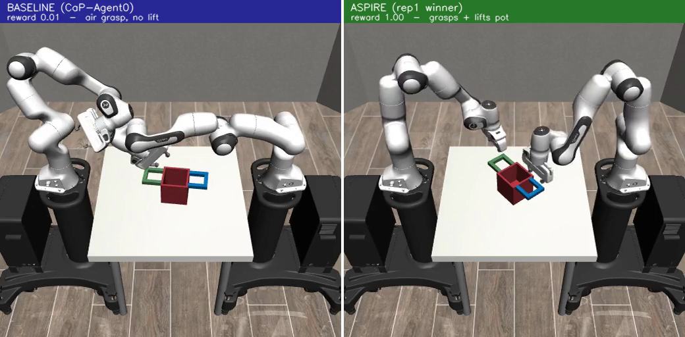

# ASPIRE Skill Accumulation Reproduction

**Simulation research**

This project reproduces and evaluates ASPIRE in simulation. The system generates and executes robot programs, records traces, repairs failures, and stores reusable skills. The focus is on skill accumulation, scoring methodology, and auditable experiments.

**Research question:** Can accumulating and retrieving earlier skills help robot programs generalize to unseen task seeds?

**Current results:** A reanalysis of the validation set reports 31/69 for the skill-library condition and 15/69 for cold start. This is a post-hoc exploratory analysis across tasks; repeated samples share tasks, so it is not a completed independent confirmatory experiment. The preregistered experiment remains incomplete. [Analysis and limitations](runs/VAL-REANALYSIS.md).

## Demos and Images

[](runs/2026-07-17-lift-repeats/clips/two_arm_lift_BEFORE_vs_AFTER_seed100.mp4)

[Watch the recorded clip](runs/2026-07-17-lift-repeats/clips/two_arm_lift_BEFORE_vs_AFTER_seed100.mp4). Two-arm lift simulation, seed 100, rep1 example. The left baseline leaves the pot on the table; the selected program on the right lifts it. This is not B601 hardware and does not represent success across all repeats.

## Work

The work covers reproduction, implementation, integration and analysis. Methods introduced in upstream ASPIRE / HarnessVLA papers remain credited to their authors. Shared code history and documentation updates are not counted as new implementation.

| Work | Details | Inspect |
|---|---|---|
| Planning, execution and trace-guided repair | Connect the coordinator, actor and execution engine, and use execution feedback to repair programs. | [Code / evidence](aspire/coordinator.py) |
| Skill storage and retrieval | Separate accumulated-skill retrieval from cold-start controls to study transfer and negative transfer. | [Code / evidence](aspire/skill_library.py) |
| Experiment scoring and analysis | Distinguish debugging-seed scores from validation generalization and retain the limits of post-hoc analysis. | [Code / evidence](scripts/reanalyze_val.py) |
| Confirmatory experiment audit | Recover 48 parseable JSON files and 2 error texts from 60 cells; 10 cells lack summaries. No completion claim is added. | [Code / evidence](docs/evidence/nov-m4/confirmatory/audit.json) |

Follow the [implementation-to-evidence mapping](docs/evidence/oct-m3/implementation-commits.csv) to inspect actual implementation commits separately from documentation and evidence-packaging commits.

## Milestones and Status

| Stage | Technical evidence | Scope |
|---|---|---|
| Foundation and interface preparation | Code navigation below; [historical technical guide](docs/history/readme-before-showcase-2026-11-14.md) | Simulation, software checks and physical trials are identified separately |
| October / M3 integration | [Implementation and verification index](docs/evidence/oct-m3/README.md) | Inspectable implementation and listed tests; not a claim that all contractual items have been accepted |
| November / M4 comparison | [Comparison and demonstration index](docs/evidence/nov-m4/README.md) | Existing results and failure analysis; wireless comparisons and two industrial demonstrations remain incomplete |
| December / M5 preparation | [Reproduction, archive and follow-up work](docs/evidence/dec-m5/README.md) | Preparation / partial evidence; full clean-machine reconstruction, final demonstration and large-file retrieval remain outstanding |

Months label delivery stages; original records give experiment dates. Evidence packaging and no-hardware checks on 2026-11-14 do not imply new physical or simulated experiments on that date. See the [reading guide](docs/portfolio/README.md) for details.

## Limitations and Next Steps

This repository does not demonstrate successful execution on physical B601 hardware. The confirmatory experiment and a complete externally retrievable large-file archive remain incomplete. Repeated two-arm demonstrations have high variance; the featured clip is one example.

## Code Navigation and Verification

| Path | Contents |
|---|---|
| `aspire/` | Planning, execution, skill library and trace structures |
| `scripts/` | Experiment scheduling and offline analysis |
| `runs/` | Study designs, results and failure records |
| `docs/evidence/` | Technical evidence organized by delivery stage |

The following is a software-check entry point for an existing configured environment. Follow the [reproduction notes](docs/evidence/dec-m5/reproduce.md) for exact dependencies and platform requirements. This documentation update did not rerun the full experiments and does not require reviewers to move a physical arm.

```sh
python3 -m pytest tests/ -q -p no:anyio
```

## Related Projects

| Project | Research / verification environment |
|---|---|
| [ASPIRE Skill Accumulation Reproduction](https://github.com/23garyd/aspire-sim-reproduction) | Simulation research |
| [ASPIRE Adapter for reBot B601](https://github.com/23garyd/aspire-robot-B601) | Software adaptation and fake-driver verification |
| [HarnessVLA Frozen-Policy and Harness Reproduction](https://github.com/23garyd/harnessvla-sim-reproduction) | LIBERO-Pro simulation research |
| [HarnessVLA Experiments on reBot B601](https://github.com/23garyd/harnessvla-rebot-b601) | Physical B601 research and engineering validation |

These are related but distinct reproduction and engineering projects. Results are reported separately. See the repository citations and license notices for upstream attribution.
