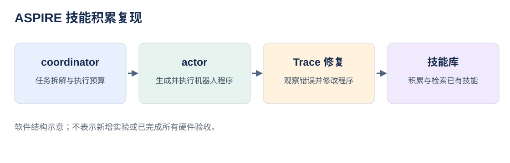

# ASPIRE Skill Accumulation Reproduction — Reading Guide

This guide connects the research question, implementation, evidence and limitations. See the [project overview](../../README.md) for demos and a summary. The [documentation index](../README.md) links to all delivery-stage evidence.

## Current Scope

This project reproduces and evaluates ASPIRE in simulation. The system generates and executes robot programs, records traces, repairs failures, and stores reusable skills. The focus is on skill accumulation, scoring methodology, and auditable experiments.

A reanalysis of the validation set reports 31/69 for the skill-library condition and 15/69 for cold start. This is a post-hoc exploratory analysis across tasks; repeated samples share tasks, so it is not a completed independent confirmatory experiment. The preregistered experiment remains incomplete.

This repository does not demonstrate successful execution on physical B601 hardware. The confirmatory experiment and a complete externally retrievable large-file archive remain incomplete. Repeated two-arm demonstrations have high variance; the featured clip is one example.

## Software Architecture

The diagram explains code boundaries. Claims about execution and measured behavior remain limited to the evidence described below.

## Work and Attribution

This project reproduces existing research and provides engineering implementation, experiments and analysis. Upstream paper methods remain attributed to their authors. The [implementation commit map](../evidence/oct-m3/implementation-commits.csv) separates code contributions from evidence packaging. The two ASPIRE repositories share history; identical files or simulation clips are not counted as separate achievements. This documentation update adds reading guidance and media entry points, with no new training, rollouts or robot actions.

## Evidence Levels

| Evidence | Supports | Does not establish |
|---|---|---|
| Source code and no-hardware tests | Interfaces, control logic, error handling and some boundaries | Physical arm motion, real calibration or physical safety |
| Simulation results and videos | Behavior in the specified simulated environment, conditions and examples | Physical B601 performance or industrial deployment |
| Hardware results, video and telemetry | The shown physical trial and its recorded outcome | Other pipelines, other tasks or unmeasured wireless performance |
| Pinned commits and hashes | Traceable source files and auditable packaged versions | Experiment timing, task success or final contractual acceptance |

See [media-provenance.json](media-provenance.json) for sources. Where present, preview images are frames extracted directly at 1 second from existing videos; generated imagery does not replace experimental footage. Architecture diagrams are explanatory illustrations, not execution evidence.

## Stages and Evidence

[October / M3](../evidence/oct-m3/README.md), [November / M4](../evidence/nov-m4/README.md) and [December / M5](../evidence/dec-m5/README.md) retain their technical scope and outstanding items. Original experiment dates are not reassigned to delivery months.

Repository access permissions are unchanged. Technical pages do not contain invoices, commercial contracts or payment information.
